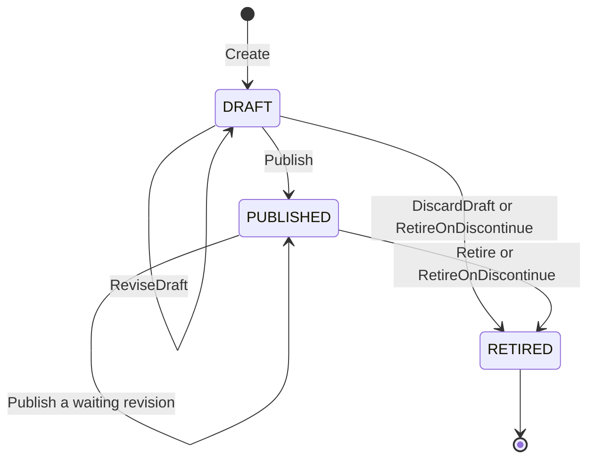
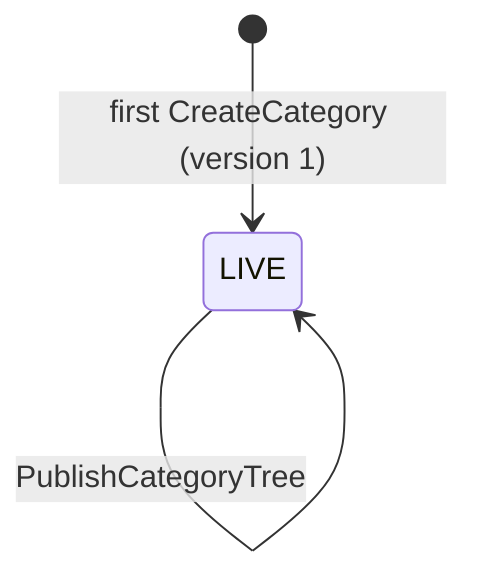

# Aggregate design canvas

Following the ddd-crew
[Aggregate Design Canvas v1.1](https://github.com/ddd-crew/aggregate-design-canvas).
This context has two aggregate roots, **ProductContent** (`internal/domain/content`)
and **CategoryTree** (`internal/domain/category`), and one read model,
**CatalogItemView**. The two aggregates share no state: the only cross-aggregate fact
is whether a category exists in the current tree, which the use case hands to
`ProductContent` as the `content.Categories` interface (`Has(categoryID)`).

## ProductContent

### 1. Name

`ProductContent` (`content.ProductContent`), identified by `catalogItemId`
(`content.ID`, 1 to 64 characters of `A-Za-z0-9._:-`).

### 2. Description

The sellable content of one catalogue item: description (at most 4000 characters),
bullets (at most 10), attributes (at most 50), media (at most 12), the primary
category, a `revision` and a `publishedRevision`. Value objects:

| Value object | Fields | Note |
| --- | --- | --- |
| `Body` | `Description`, `Bullets`, `Attributes`, `Media`, `PrimaryCategoryID` | The editable part. Create and the revise commands replace it as a whole. |
| `Attribute` | `Name`, `Value`, `Unit` (optional) | One named fact of the item. |
| `Media` | `MediaID`, `URL`, `AltText`, `Role` (`PRIMARY` or `GALLERY`) | A URL to a static asset, upload is out of scope. Exactly one `PRIMARY` at publish. |

Bookkeeping fields: `state`, `retiredReason`, `revision`, `publishedRevision`,
`createdAt`, `updatedAt`, `publishedAt`, `retiredAt` and `version`.

Source: `internal/domain/content/content.go`.

### 3. State transitions

Source: `internal/domain/content/commands.go` (`Create`, `ReviseDraft`,
`ReviseContent`, `Publish`, `Retire`, `DiscardDraft`, `RetireOnDiscontinue`).

- A DRAFT is editable and discardable. `DiscardDraft` retires it with reason
  `DISCARDED` and raises no event, because nothing was ever published.
- `ReviseContent` edits live content in place and takes a new `revision`, but
  shoppers see it only after the next `Publish`, which publishes the current revision.
  Publishing PUBLISHED content whose `publishedRevision` equals `revision` changes
  nothing and raises nothing.
- `RETIRED` carries a reason: `MANUAL`, `DISCARDED` or `DISCONTINUED`. Only the
  retirement of PUBLISHED content raises `ProductContentRetired`. `RETIRED` is terminal.

### 4. Enforced invariants

| Invariant | Enforced by |
| --- | --- |
| The item is known to the local `catalog_item_view` | `Create`, `Publish` → `ErrUnknownCatalogItem` |
| Content is neither created nor published for a discontinued item | `Create`, `Publish` → `ErrItemDiscontinued` |
| At most 10 bullets, 50 attributes, 12 media (checked before the fields) | `Create`, `ReviseDraft`, `ReviseContent` → `ErrTooManyBullets`, `ErrTooManyAttributes`, `ErrTooManyMedia` |
| Field limits: description 4000, bullet 300, attribute name 100 / value 300 / unit 20, alt text 200, URL absolute http(s) up to 2048, unique valid `mediaId`, valid role | the same commands → `shared.ErrValidation` |
| `primaryCategoryId`, when given, is in the current tree | `Create`, `ReviseDraft`, `ReviseContent`, `Publish` → `ErrUnknownCategory` |
| Publish needs a description, exactly one `PRIMARY` medium and a category | `Publish` → `ErrIncompleteContent` |
| PUBLISHED content must stay complete when revised | `ReviseContent` → `ErrIncompleteContent` |
| RETIRED content never changes or publishes again | `ReviseDraft`, `ReviseContent`, `Publish` → `ErrContentRetired` |
| `ReviseDraft` applies to a DRAFT only and `ReviseContent` to PUBLISHED only (the use case picks by state) | `shared.ErrIllegalTransition` on the wrong state |
| Only PUBLISHED content retires, only a DRAFT is discarded | `Retire`, `DiscardDraft` → `shared.ErrIllegalTransition` |

A DRAFT may be incomplete (no description, no media, no category): completeness is the
publish gate, not a creation rule.

### 5. Corrective policies

| Policy | Owner | Rule | Effect on this aggregate |
| --- | --- | --- | --- |
| `RetireOnDiscontinue` | this context | On `CatalogItemDiscontinued`, retire the item's content. | PUBLISHED to RETIRED with `ProductContentRetired`, DRAFT to RETIRED silently, both with reason `DISCONTINUED`. RETIRED content is left alone. |
| Idempotent consumption | this context | Every consumed event is applied once (inbox on the CloudEvents `id`). | `catalog_item_view` never double-applies. |

### 6. Handled commands

| Command | Trigger | Transition |
| --- | --- | --- |
| `Create` | REST `POST /product-contents` | none to `DRAFT` |
| `ReviseDraft` | REST `POST /product-contents/{catalogItemId}/revisions` on a DRAFT | `DRAFT` to `DRAFT` |
| `ReviseContent` | the same route on PUBLISHED content | `PUBLISHED` to `PUBLISHED` |
| `Publish` | REST `POST /product-contents/{catalogItemId}/publications` | `DRAFT` to `PUBLISHED`, `PUBLISHED` to `PUBLISHED` |
| `DiscardDraft` | REST `DELETE /product-contents/{catalogItemId}/draft` | `DRAFT` to `RETIRED` (`DISCARDED`) |
| `Retire` | REST `POST /product-contents/{catalogItemId}/retirements` | `PUBLISHED` to `RETIRED` (`MANUAL`) |
| `RetireOnDiscontinue` | Kafka `CatalogItemDiscontinued` | `PUBLISHED` or `DRAFT` to `RETIRED` (`DISCONTINUED`) |

### 7. Created events

| Event | Raised when | Full CloudEvents type |
| --- | --- | --- |
| `ProductContentPublished` | `Publish` is saved (new `publishedRevision`) | `com.retailnetwork.storefront.product-content.productcontent.ProductContentPublished` |
| `ProductContentRetired` | `Retire`, or `RetireOnDiscontinue` of PUBLISHED content, is saved | `com.retailnetwork.storefront.product-content.productcontent.ProductContentRetired` |

Create, `ReviseDraft`, `ReviseContent` and `DiscardDraft` raise no event: the two
events name the two state changes that leave the boundary. Both leave through the
transactional outbox in the same transaction as the save.

### 8. Throughput

*Estimate.* Authoring traffic is human; the only automated writer is
`RetireOnDiscontinue`, one command per discontinued item. Contention on one content is
a content manager and the policy at worst. Every save is guarded by the `version` the
aggregate was loaded with (`UPDATE ... WHERE version = ?`), and a lost race retries
once for a command and up to five times for a consumed event, then answers
`409 concurrent-update`.

### 9. Size

*Estimate.* One row per catalogue item (`product_contents`), the three collections as
`jsonb` columns: at most 10 bullets, 50 attributes and 12 media. It lives from creation
until retirement, then stays as a record (`RETIRED` is terminal but the row remains,
and the REST read still returns it).

## CategoryTree

### 1. Name

`CategoryTree` (`category.Tree`), identified by the tree id `main`
(`category.TreeID`).

### 2. Description

The single, live, versioned category tree a shopper browses. Categories are created,
moved and renamed on the live tree and every command publishes a new version. The
tree is stored whole as one `jsonb` row. One value object:

| Value object | Fields | Note |
| --- | --- | --- |
| `Category` | `ID`, `ParentID` (empty for a root), `Name`, `Path` | One node. `Path` is derived: the names from the root joined with `/`. |

Source: `internal/domain/category/category.go`.

### 3. State transitions

Source: `internal/domain/category/category.go` (`publish`, `CreateCategory`,
`MoveCategory`, `RenameCategory`, `PublishCategoryTree`).

There is no draft state: every command applies to the live tree and `publish` bumps
the version, so the aggregate version and the published tree version are the same
number. Before the first category the tree is the empty tree (`NewTree`, version 0,
never stored). `PublishCategoryTree` changes no category: it publishes the live tree
again under a new version, the way to re-send it to a consumer.

### 4. Enforced invariants

| Invariant | Enforced by |
| --- | --- |
| The tree never contains a cycle | `MoveCategory` → `ErrCategoryCycle` |
| Depth at most 4 (a root is level 1) | `CreateCategory`, `MoveCategory` → `ErrMaxDepth` |
| Siblings never share a name, compared case-insensitively | `CreateCategory`, `MoveCategory`, `RenameCategory` → `ErrDuplicateSiblingName` |
| The tree holds at most 5000 categories | `CreateCategory` → `ErrTooManyCategories` (a validation error) |
| Names are trimmed text of 1 to 100 characters without `/`, ids are new valid ids | the three edit commands → `shared.ErrValidation` |
| The named category and parent exist | `ErrCategoryNotFound`, `ErrUnknownParent` |
| A category in use by PUBLISHED content is never removed | no remove command by design, `ErrCategoryInUse` is declared and raised by nothing |

### 5. Corrective policies

None. Structural invariants are refused, not repaired.

### 6. Handled commands

| Command | Trigger | Transition |
| --- | --- | --- |
| `CreateCategory` | REST `POST /categories` | `LIVE` to `LIVE` (the first one creates the tree) |
| `MoveCategory` | REST `PUT /categories/{categoryId}/parent` | `LIVE` to `LIVE` |
| `RenameCategory` | REST `PUT /categories/{categoryId}/name` | `LIVE` to `LIVE` |
| `PublishCategoryTree` | REST `POST /category-tree-publications` | `LIVE` to `LIVE` |

### 7. Created events

| Event | Raised when | Full CloudEvents type |
| --- | --- | --- |
| `CategoryTreePublished` | any of the four commands is saved (version bumped) | `com.retailnetwork.storefront.product-content.categorytree.CategoryTreePublished` |

`product-discovery` learns each new tree version through this event, which carries the
whole tree under one `version`.

### 8. Throughput

*Estimate.* Rare: trees are edited in batches by a content manager, a few commands per
session. Writers are serialised by the tree row's `version`.

### 9. Size

*Estimate.* One tree, about 10^3 categories by design and 5000 at most. One row with a
`jsonb` array; the whole tree fits one event payload.

## Read models

| Read model | Source events | Serves | Why it is not an aggregate |
| --- | --- | --- | --- |
| `CatalogItemView` (`readmodel.CatalogItem`, table `catalog_item_view`) | `offer-availability` `CatalogItemCreated`, `CatalogItemDiscontinued` | The `ErrUnknownCatalogItem` and `ErrItemDiscontinued` checks in create and publish, and the trigger of `RetireOnDiscontinue` | It protects no invariant of its own and takes no command. It is a projection of facts `offer-availability` owns and can be rebuilt by replaying the topic. Only `catalogItemId` and the discontinued flag are kept. `DISCONTINUED` is terminal. |

Source: `internal/application/readmodel/readmodel.go`,
`internal/application/usecases/consume.go`.
