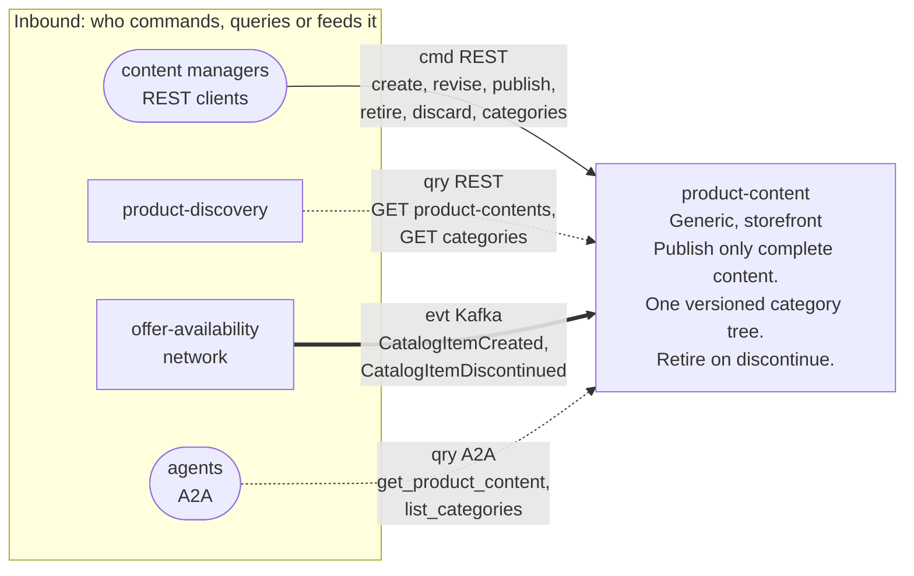
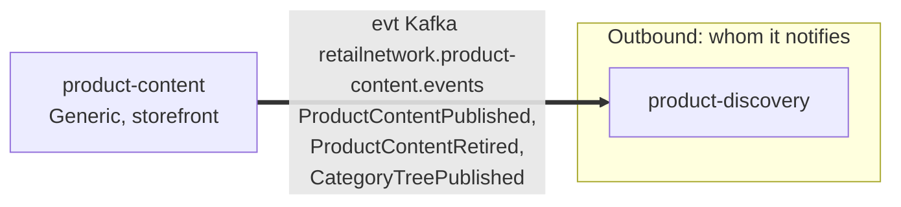

# Bounded context canvas

Following the ddd-crew
[Bounded Context Canvas v5](https://github.com/ddd-crew/bounded-context-canvas).
Every message row comes from the code on this branch (`apis/openapi.yaml`,
`apis/asyncapi.yaml`, `internal/adapters/inbound`, `internal/adapters/outbound/kafka`).

## Canvas at a glance

Two pictures of the sections below: first the inbound collaborators feeding this
context, then the outbound collaborators it notifies. Arrows follow the message type:
**solid** commands, **dotted** queries, **thick** events. The tables carry the exact
route, topic and CloudEvents type of every message.

### Inbound

Source: `internal/adapters/inbound/http/server.go` (routes),
`internal/adapters/inbound/kafka/offer_availability.go` (consumed types),
`internal/adapters/inbound/a2a/skills.go` (skills).

### Outbound

Source: `internal/adapters/outbound/kafka/encoder.go` (topic and payloads),
`apis/asyncapi.yaml`.

This context makes **no synchronous calls**: the item data it needs is the local,
event-fed `catalog_item_view`. It has no outbound HTTP, MCP or A2A client.

## Name

**Product Content** (`product-content`, CloudEvents tier `storefront`,
`cloudevents.Context = "product-content"`).

## Purpose

To enrich the network's catalogue item with everything a product page needs and the
item master does not have. The context:

- holds the sellable content of one item (description, bullets, attributes, media,
  primary category) as one versioned, publishable unit;
- publishes content only when complete: a description, exactly one `PRIMARY` medium
  and a category in the current tree (`ErrIncompleteContent`, `ErrUnknownCategory`);
- owns the single, live, versioned category tree, at most four levels deep;
- retires published and draft content when the network discontinues the item
  (`RetireOnDiscontinue`); a discontinued item can never publish
  (`ErrItemDiscontinued`).

## Strategic classification

| Axis | Verdict |
| --- | --- |
| **Domain** | **Generic** subdomain. See the [Core domain chart](/docs/ddd/core-domain-chart) and [Subdomain classification](/docs/ddd/subdomain-classification). |
| **Business model** | Engagement enabler (a production shop buys a PIM). |
| **Evolution** | Commodity. |

## Domain roles

| Role | Applies? | Evidence in the code |
| --- | --- | --- |
| **Specification (content of an item)** | **Yes, primary** | The publish gate (`complete`, `ErrUnknownCategory` in `internal/domain/content/commands.go`) defines what sellable content must look like. |
| **Master data (category tree)** | **Yes** | `category.Tree` is the one versioned tree every content references by `primaryCategoryId`. |
| Execution | No | No transactional flow runs here: commands are authoring actions. |
| Analysis / Gateway | No | The reads are projections for `product-discovery`'s bootstrap, not decisions. Shoppers reach the catalogue through `product-discovery`, not here. |

## Inbound communication

| Collaborator | Message | Type | Channel | Relationship |
| --- | --- | --- | --- | --- |
| Content manager (human or tool) | `CreateProductContent`, `ReviseContent` (state picks `ReviseDraft` or `ReviseContent`), `PublishContent`, `RetireContent`, `DiscardDraft` | Command | REST `POST /product-contents`, `POST /product-contents/{catalogItemId}/revisions`, `/publications`, `/retirements`, `DELETE .../draft` | UI |
| Content manager | `CreateCategory`, `MoveCategory`, `RenameCategory`, `PublishCategoryTree` | Command | REST `POST /categories`, `PUT /categories/{categoryId}/parent`, `PUT .../name`, `POST /category-tree-publications` | UI |
| Content manager | `GetProductContent`, `ListProductContents`, `ListCategories` | Query | REST `GET /product-contents/{catalogItemId}`, `GET /product-contents`, `GET /categories` | UI |
| `product-discovery` | `ListProductContents`, `ListCategories` | Query | REST `GET /product-contents` (bootstrap, paged), `GET /categories` | Customer/Supplier (we are the Supplier) |
| Agents | `GetProductContent`, `ListCategories` | Query | A2A skills `get_product_content`, `list_categories` | Open host for delegation, read-only |
| `offer-availability` | `CatalogItemCreated` | Event | Kafka `retailnetwork.offer-availability.events`, `com.retailnetwork.commerce.offer-availability.catalogitem.CatalogItemCreated` | Conformist |
| `offer-availability` | `CatalogItemDiscontinued` | Event | same topic, `com.retailnetwork.commerce.offer-availability.catalogitem.CatalogItemDiscontinued` | Conformist |

## Outbound communication

| Collaborator | Message | Type | Channel | Relationship |
| --- | --- | --- | --- | --- |
| `product-discovery` | `ProductContentPublished` | Event | Kafka `retailnetwork.product-content.events`, `com.retailnetwork.storefront.product-content.productcontent.ProductContentPublished` | Customer/Supplier (we are the Supplier) |
| `product-discovery` | `ProductContentRetired` | Event | same topic, `com.retailnetwork.storefront.product-content.productcontent.ProductContentRetired` | Customer/Supplier |
| `product-discovery` | `CategoryTreePublished` | Event | same topic, `com.retailnetwork.storefront.product-content.categorytree.CategoryTreePublished` | Customer/Supplier |

`product-discovery` folds each event into its product and category views, guarded by
the content `revision` and the tree `version` as monotonic guards (verified on its
`origin/develop`, see [Integration](/docs/ecosystem/integration)). Payloads are on
[Domain events](/docs/ddd/domain-events), relationship evidence on the
[Context map](/docs/ddd/context-map).

## Ubiquitous language

Full glossary: [Ubiquitous language](/docs/ddd/ubiquitous-language). Top terms:
**Product Content**, **Revision**, **Primary medium**, **Category**, **Category tree**.

## Business decisions

1. **Content publishes only when complete**: a description, exactly one `PRIMARY`
   medium and a category in the current tree (`incomplete-content`,
   `unknown-category`).
2. **Only `catalogItemId` crosses the boundary**; content never redefines the item.
   The item must exist in the local `catalog_item_view` (`unknown-catalog-item`) and
   must not be discontinued (`item-discontinued`) to create or publish content.
3. **The category tree is one live, versioned aggregate** with no draft state: every
   command applies to the live tree and publishes a new version, at most four levels
   deep (`max-depth`), never cyclic (`category-cycle`), with unique sibling names
   (`duplicate-sibling-name`). `category-in-use` guards a future removal: categories
   are only created, moved and renamed.
4. **RETIRED content never changes or publishes again** (`content-retired`).
5. **Publishing the revision that is already live changes nothing** and raises no
   event (ADR 0002, A1).

## Assumptions

- `offer-availability` publishes `CatalogItemCreated` before a content manager writes
  content for the item. Content for an unknown item is rejected, so an early write
  fails rather than waits (and may be mere projection lag).
- `CatalogItemDiscontinued` eventually reaches this context for every discontinued
  item; until it does, published content stays up (`product-discovery`'s purchasable
  rule also requires an active item in the item master).
- Media URLs point at static assets that exist; nothing here fetches a URL.
- Every consumed event carries `data.catalogItemId`, the only field this context uses.
- Exactly one consumer of the published events is known (`product-discovery`).
  Nothing is written to `retailnetwork.product-content.analytics`.

## Verification metrics

What exists today is the `content.products.published` counter (outcome and reason) and
the fleet's HTTP RED metrics; see [Observability](/docs/operations/observability).
The rest are queries an operator can run against the schema.

| Metric | Target | Source |
| --- | --- | --- |
| Publish success rate and rejected reasons | tracked | `content.products.published` (`outcome`, `reason`) |
| Published content without a matching `ProductContentPublished` outbox row | 0 | `product_contents.published_revision` against `outbox_events` |
| Age of the oldest unpublished event | seconds | `outbox_events.created_at` where `published_at IS NULL` |
| Outbox rows stuck at the attempt cap | 0 | `outbox_events.attempts >= OUTBOX_MAX_ATTEMPTS` |
| Consumer lag on `retailnetwork.offer-availability.events` | seconds | Kafka consumer group lag |
| PUBLISHED content of DISCONTINUED items | 0 beyond one lag window | join `product_contents` and `catalog_item_view` |

## Open questions

None in the code. The gaps of the design source (editable drafts, republication, a
route for the tree publication, collection limits, retire-on-discontinue of drafts,
the no-draft tree) are resolved by [ADR 0002](/docs/adr/0002-product-content-assumptions).
