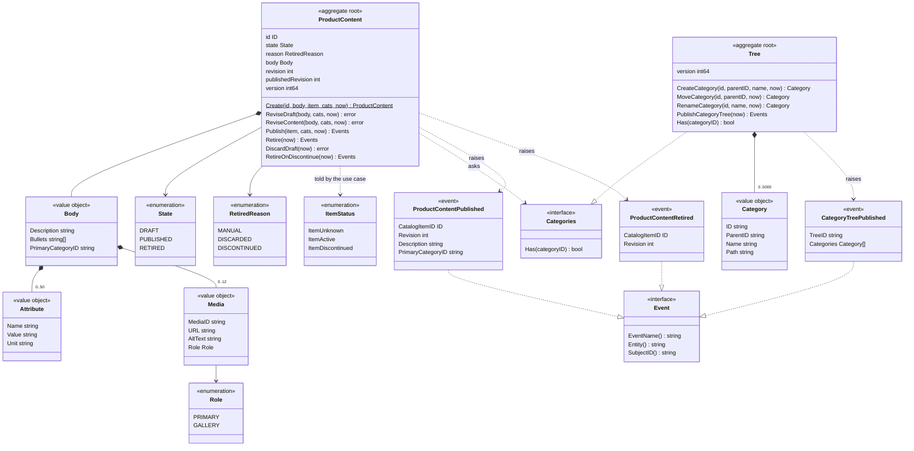

# Class diagrams

Two UML class diagrams, both derived from the Go source: the domain types of the two
aggregates, and the hexagonal ports with the adapters that implement them.

## Domain model

Source: `internal/domain/content/content.go`, `commands.go`, `events.go`,
`internal/domain/category/category.go`, `events.go`,
`internal/domain/shared/shared.go`. Unexported fields, getters and the snapshot types
are omitted; `Events` stands for `[]shared.Event`. The content package never imports
the category package: it sees the tree only through `Categories`.

## Ports and adapters

```mermaid
classDiagram
    class UnitOfWork {
        <<port>>
        Do(ctx, fn) error
    }
    class ContentRepository {
        <<port>>
        Get(ctx, id) ProductContent
        Save(ctx, content) error
        List(ctx, after, limit) ProductContent[]
    }
    class TreeRepository {
        <<port>>
        Get(ctx) Tree
        Save(ctx, tree) error
    }
    class CatalogItemRepository {
        <<port>>
        Get(ctx, id) CatalogItem
        MarkActive(ctx, id, at) error
        MarkDiscontinued(ctx, id, at) error
    }
    class Inbox {
        <<port>>
        Claim(ctx, eventID, eventType) bool
    }
    class EventOutbox {
        <<port>>
        Append(ctx, events) error
    }
    class IdempotencyStore {
        <<port>>
        Get(ctx, route, key) Record
        Put(ctx, route, key, rec) bool
    }
    class ContentMetrics {
        <<port>>
        ContentPublished(ctx)
        ContentPublishRejected(ctx, reason)
    }
    class Clock {
        <<port>>
        Now() time
    }
    class IDGenerator {
        <<port>>
        NewCategoryID() string
    }
    class UseCases {
        <<application>>
        CreateProductContent
        ReviseContent
        PublishContent
        RetireContent
        DiscardDraft
        CreateCategory
        MoveCategory
        RenameCategory
        PublishCategoryTree
        GetProductContent
        ListProductContents
        ListCategories
        Consumer
    }
    class HTTPServer {
        <<inbound adapter>>
        chi router, problem+json
    }
    class OfferAvailabilityConsumer {
        <<inbound adapter>>
        retry, dead letter
    }
    class A2AServer {
        <<inbound adapter>>
        get_product_content, list_categories
    }
    class PostgresAdapters {
        <<outbound adapter>>
        repositories, pgtx unit of work,
        OutboxRepo, Inbox, IdempotencyStore
    }
    class KafkaEncoder {
        <<outbound adapter>>
        Encoder, Sink, BrokerCheck
    }
    class OutboxRelay {
        <<outbound adapter>>
        drains outbox_events
    }
    class MemoryAdapters {
        <<test double>>
        in-memory ports
    }
    HTTPServer --> UseCases
    OfferAvailabilityConsumer --> UseCases
    A2AServer --> UseCases : two read use cases
    UseCases --> UnitOfWork
    UseCases --> ContentRepository
    UseCases --> TreeRepository
    UseCases --> CatalogItemRepository
    UseCases --> Inbox
    UseCases --> EventOutbox
    UseCases --> ContentMetrics
    UseCases --> Clock
    UseCases --> IDGenerator
    HTTPServer --> IdempotencyStore
    PostgresAdapters ..|> UnitOfWork
    PostgresAdapters ..|> ContentRepository
    PostgresAdapters ..|> TreeRepository
    PostgresAdapters ..|> CatalogItemRepository
    PostgresAdapters ..|> Inbox
    PostgresAdapters ..|> EventOutbox
    PostgresAdapters ..|> IdempotencyStore
    MemoryAdapters ..|> ContentRepository
    MemoryAdapters ..|> TreeRepository
    OutboxRelay --> PostgresAdapters : drains
    OutboxRelay --> KafkaEncoder : sends
```

Source: `internal/application/ports/ports.go` (the OUT ports),
`internal/application/usecases/deps.go` (`Deps`), `cmd/api/main.go` and
`cmd/a2a/main.go` (composition roots), `internal/adapters/inbound/*`,
`internal/adapters/outbound/*`. The in-memory adapters are a test double: no
`cmd/**` file imports them (`TestRuntimeBinaryHasNoInMemoryAdapters`), and the
A2A adapter reaches only the two read use cases. The Postgres box stands for several
types (`ContentRepository`, `TreeRepository`, `CatalogItemRepository`, `Inbox`,
`OutboxRepo`, `IdempotencyStore`, `UnitOfWork`); the memory box implements the same
ports for the unit and BDD suites. The `Encoder` runs inside `OutboxRepo.Append`, so
events are stored already encoded.
