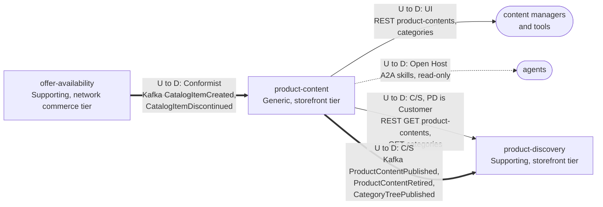

# Context map

Following ddd-crew [Context Mapping](https://github.com/ddd-crew/context-mapping).
This is **product-content's slice** of the storefront context map: every
relationship this context has, with the upstream (U) and downstream (D) side, the
pattern and the channel.

Source: `internal/adapters/inbound/http/server.go`,
`internal/adapters/inbound/a2a/skills.go`,
`internal/adapters/inbound/kafka/offer_availability.go`,
`internal/adapters/outbound/kafka/encoder.go`, and `product-discovery`'s
`cmd/rebuild/main.go` and `internal/adapters/inbound/kafka/product_content.go` on its
`origin/develop`.

Legend: arrows point from upstream to downstream. A solid arrow is a synchronous REST
relationship, a dotted arrow a read-only delegation, a thick arrow a Kafka event
relationship. This context makes **no synchronous calls**: the item data its
invariants need arrives as events into the local `catalog_item_view`.

Omitted, because they have no edge with this context (**Separate Ways**): the
storefront contexts `pricing`, `shopping-cart`, `checkout` and `customer-payments` (a
price, a cart or a payment never names content: the product page assembles them in
`product-discovery`), and every network context except `offer-availability`. The
shopper has no edge: the browser reaches the storefront edge and reads the catalogue
through `product-discovery`, never here. No edge touches the warehouse-systems fleet.

## Relationships

| Neighbour | Direction | Pattern | Channel | Messages | Why this pattern |
| --- | --- | --- | --- | --- | --- |
| Content managers and tools | PC upstream, manager downstream | **UI** | REST `POST /product-contents`, `:revise`, `:publish`, `:retire`, `:discard`, `POST /categories`, `:move`, `:rename`, `POST /categories:publish` | the nine commands of [Use cases](/docs/ddd/use-cases) | Authoring is a human workflow and the API is the tool's surface. No authentication, fleet-wide. |
| Agents | PC upstream, agent downstream | **Open Host Service** (delegation only) | A2A JSON-RPC on `cmd/a2a` | `get_product_content`, `list_categories` | Agents are delegated to, never delegated from: no write skill, no outbound A2A client. Facts still travel as CloudEvents. |
| `product-discovery` (Supporting) | PC upstream, PD downstream | **Customer/Supplier** (PD is the Customer) | REST `GET /product-contents` (paged), `GET /categories` | `ListProductContents`, `ListCategories` | PD's projection rebuild needs paged reads shaped for its bootstrap. PC serves them deliberately, on an operations path, never on a shopper request. `GET /product-contents/{catalogItemId}` is served too but PD's rebuild does not use it. |
| `product-discovery` (Supporting) | PC upstream, PD downstream | **Customer/Supplier** | Kafka `retailnetwork.product-content.events` | `ProductContentPublished`, `ProductContentRetired`, `CategoryTreePublished` | PD folds these into its product and category views. The payload (revision, full content, the whole tree per version) fits that one consumer, so it never calls back. |
| `offer-availability` (network, Supporting) | OA upstream, PC downstream | **Conformist** | Kafka `retailnetwork.offer-availability.events` | `CatalogItemCreated`, `CatalogItemDiscontinued` | The item master is the network's. This context takes the item facts as published into `catalog_item_view` and retires content on discontinuation. It uses only `catalogItemId`. |

## Notes on the patterns

- **No Anti-Corruption Layer.** The one upstream is inside the same organisation and
  speaks the network's language. The consumer reads the events as published and keeps
  only the id plus the discontinued flag.
- **No Shared Kernel.** `catalogItemId` and `categoryId` are values copied from
  messages, not shared code. There is no shared Go module.
- **No Open Host Service for shoppers.** The REST reads exist for one named customer
  (`product-discovery`) and operators. The shopper-facing catalogue reads live in
  `product-discovery`.
- **No synchronous call at all.** Completeness and discontinuation are checked
  against the local `catalog_item_view`, so publishing never waits on the network.
- **No fleet edge.** This context never consumes a `warehouse.*` topic and never calls
  a warehouse-systems service.
