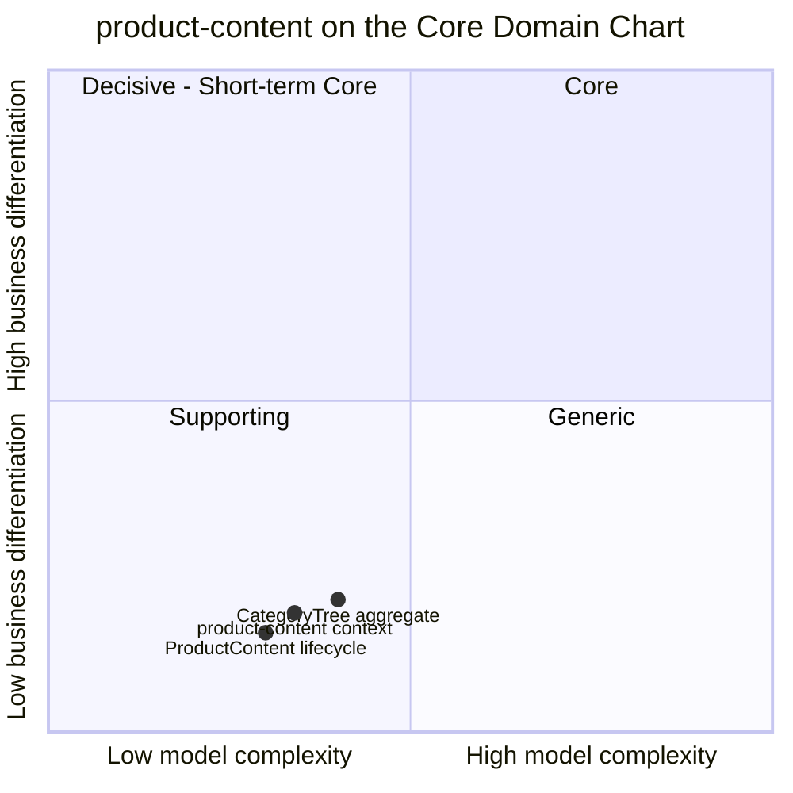

# Core domain chart

Following the ddd-crew [Core Domain Charts](https://github.com/ddd-crew/core-domain-charts):
business differentiation (y) against model complexity (x). The verdict and its
reasoning are on [Subdomain classification](/docs/ddd/subdomain-classification).

Source: the context point (complexity 0.34, differentiation 0.18) is the one
the storefront model gives (warehouse-docs `storefront/model/model.yaml`,
`contexts[product-content].chart`). The two slice points are placed by judgement
from `internal/domain/content/content.go` and `internal/domain/category/category.go`;
the model gives only the context's point. The other five storefront contexts are
omitted: their positions are on their own sites.

## Classification: Generic

All three points sit in the bottom-left corner of the chart, the quadrant the chart
labels Supporting. The verdict still comes from the model, which classifies the
context as `Generic`: the axes say only "low differentiation on low complexity", and
the Supporting-versus-Generic call is a build-versus-buy question, not a coordinate.
This one is a buy: every online shop has product descriptions, media and a category
tree, and no shopper chooses this storefront because of how its content records work.

**Differentiation is low (y = 0.18).** The context makes no selling decision. It
never prices, never promises, never decides what is in stock. Its rules are ordinary
content-management rules: publish only complete content (`content.complete` in
`commands.go`), keep the tree acyclic and shallow (`category.go`), take content down
when the item goes away (`RetireOnDiscontinue`).

**Complexity is low to moderate (x = 0.34).** It is the simplest storefront context
that still has a lifecycle:

- `ProductContent` has three states and eight transitions (create, revise draft,
  revise published, publish, republish, retire, discard and retire on discontinue),
  and the only non-trivial invariant is the publish gate.
- `CategoryTree` is one aggregate with structural invariants (no cycle, at most four
  levels, unique sibling names, at most 5000 categories): textbook tree maintenance.
- It consumes a single upstream topic and calls nothing synchronously.
- The plumbing (transactional outbox, inbox, CloudEvents) is the fleet's standard
  building blocks, not domain complexity.

## Business model

**Engagement enabler.** The context earns nothing by itself. Its value is the
conversion it does not lose: complete, accurate content is what makes a found item
buyable, and `product-discovery` counts PUBLISHED content as one of the conditions of
a purchasable item.

## Evolution

| Part | Evolution stage | Why |
| --- | --- | --- |
| Content record, publish gate, retirement | **Commodity** | Standard PIM functionality; a bought product would fit. |
| Category tree, versioned | **Commodity** | Taxonomy management with publication is what every PIM and shop platform already does. |
| Plumbing (outbox, inbox, CloudEvents) | **Commodity** | Fleet-wide building blocks. |

**Movement to watch.** Nothing in the code moves this context up. The expected path
for a Generic subdomain applies: in production this context would be replaced by a
bought PIM, shrinking to an adapter that republishes the PIM's content as
`ProductContentPublished` and `CategoryTreePublished`. The interface to keep stable is
the three published events and the two paged reads `product-discovery` uses to
rebuild its projection.
