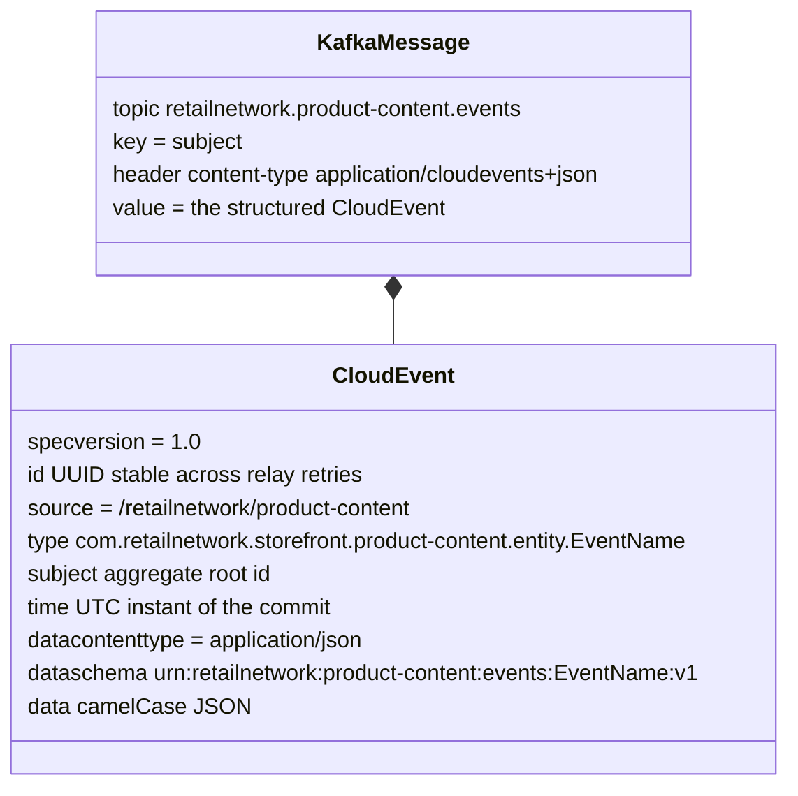
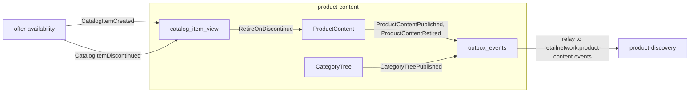

# Domain events

Every event this context raises or consumes, with the full CloudEvents type, topic,
key, payload, producer and consumers. The code wins; the contract is
`apis/asyncapi.yaml` (AsyncAPI 3.0.0) and the catalogue is
[ADR 0004](/docs/adr/0004-cloudevents-envelope-and-type-catalogue). The short list is
the [event catalogue](/docs/api-reference/events).

## Envelope

Built and decoded only in `internal/adapters/kafka/cloudevents` (constants
`Tier = "storefront"`, `Context = "product-content"`,
`Source = "/retailnetwork/product-content"`):

Source: `internal/adapters/outbound/kafka/encoder.go` (`buildMessage`),
`internal/adapters/kafka/cloudevents/cloudevents.go`.

`data` uses camelCase, optional fields are omitted when unset (never `null`) and
arrays are always present. A breaking payload change is a new `.v2` type and
dataschema.

## Published events

All three go to `retailnetwork.product-content.events` through the transactional
outbox. Nothing goes to `retailnetwork.product-content.analytics`.

### ProductContentPublished

| Attribute | Value |
| --- | --- |
| Type | `com.retailnetwork.storefront.product-content.productcontent.ProductContentPublished` |
| Key / subject | `catalogItemId` |
| Producer | `ProductContent.Publish` (use case `PublishContent`) |
| Raised when | a revision is published: DRAFT to PUBLISHED, or PUBLISHED to PUBLISHED with a waiting revision. Nothing is raised when the current revision is already published. |
| Consumers | `product-discovery` (applies a revision only above the last one it holds) |

| `data` field | Type | Notes |
| --- | --- | --- |
| `catalogItemId` | string | The aggregate root id. |
| `revision` | integer, at least 1 | The published revision. |
| `description` | string | At most 4000 characters. |
| `bullets` | string array | At most 10, each at most 300 characters. |
| `attributes` | array of `{name, value, unit?}` | At most 50. `unit` is omitted when empty. |
| `media` | array of `{mediaId, url, altText, role}` | At most 12, exactly one with role `PRIMARY` (the other role is `GALLERY`). |
| `primaryCategoryId` | string | A category of the tree at publish time. |

### ProductContentRetired

| Attribute | Value |
| --- | --- |
| Type | `com.retailnetwork.storefront.product-content.productcontent.ProductContentRetired` |
| Key / subject | `catalogItemId` |
| Producer | `ProductContent.Retire` (use case `RetireContent`) and `RetireOnDiscontinue` for PUBLISHED content |
| Raised when | PUBLISHED content is retired. Discarding a DRAFT and retiring a DRAFT on discontinuation raise nothing. |
| Consumers | `product-discovery` (the item leaves search and is no longer purchasable) |

| `data` field | Type | Notes |
| --- | --- | --- |
| `catalogItemId` | string | The aggregate root id. |
| `revision` | integer, at least 1 | The content revision at retirement. The retired reason (`MANUAL` or `DISCONTINUED`) is on the REST read, not on the event. |

### CategoryTreePublished

| Attribute | Value |
| --- | --- |
| Type | `com.retailnetwork.storefront.product-content.categorytree.CategoryTreePublished` |
| Key / subject | `main` |
| Producer | `Tree.CreateCategory`, `MoveCategory`, `RenameCategory`, `PublishCategoryTree` |
| Raised when | any of the four commands is saved. The tree has no draft state, so every command publishes a new version. |
| Consumers | `product-discovery` (replaces its category view when `version` is above the last applied one) |

| `data` field | Type | Notes |
| --- | --- | --- |
| `version` | integer, at least 1 | The tree version. |
| `categories` | array of `{categoryId, parentId?, name, path}` | The whole tree, ordered by path (parents before children). `parentId` is omitted for a root, `path` is the names from the root joined with `/`. |

Source for the three: `internal/domain/content/events.go`,
`internal/domain/category/events.go`, the payload structs in
`internal/adapters/outbound/kafka/encoder.go`, `apis/asyncapi.yaml`.

## Consumed events

| Type | Topic | Producer | Used | Handler |
| --- | --- | --- | --- | --- |
| `com.retailnetwork.commerce.offer-availability.catalogitem.CatalogItemCreated` | `retailnetwork.offer-availability.events` | `offer-availability` | `data.catalogItemId` | `usecases.Consumer.ApplyCatalogItemCreated` inserts the item `ACTIVE` unless it is already known |
| `com.retailnetwork.commerce.offer-availability.catalogitem.CatalogItemDiscontinued` | `retailnetwork.offer-availability.events` | `offer-availability` | `data.catalogItemId` | `usecases.Consumer.ApplyCatalogItemDiscontinued` marks the item `DISCONTINUED` and runs RetireOnDiscontinue |

Every other field and every other type is ignored. Source:
`internal/adapters/inbound/kafka/offer_availability.go`. The consumed contract is
owned by `offer-availability`; see [Integration](/docs/ecosystem/integration) for the
verification of the producer side.

## Event flow

Source: `internal/application/usecases/consume.go`, `content.go`, `category.go`,
`internal/adapters/outbound/outbox/relay.go`.

## Delivery guarantees

- **Publish**: at least once. The `id` is minted when the event is encoded and
  stored with the outbox row, so a retry sends the same `id`. A row that fails
  `OUTBOX_MAX_ATTEMPTS` times is excluded and logged at ERROR.
- **Ordering**: events of one item share a Kafka key and are ordered on one
  partition; the consumer's guard is the monotonic `revision` (content) and `version`
  (tree).
- **Consume**: at least once. The inbox on the CloudEvents `id` makes the effect
  exactly-once per id; poison messages and messages that fail five times go to
  `retailnetwork.offer-availability.events.dlq`.
