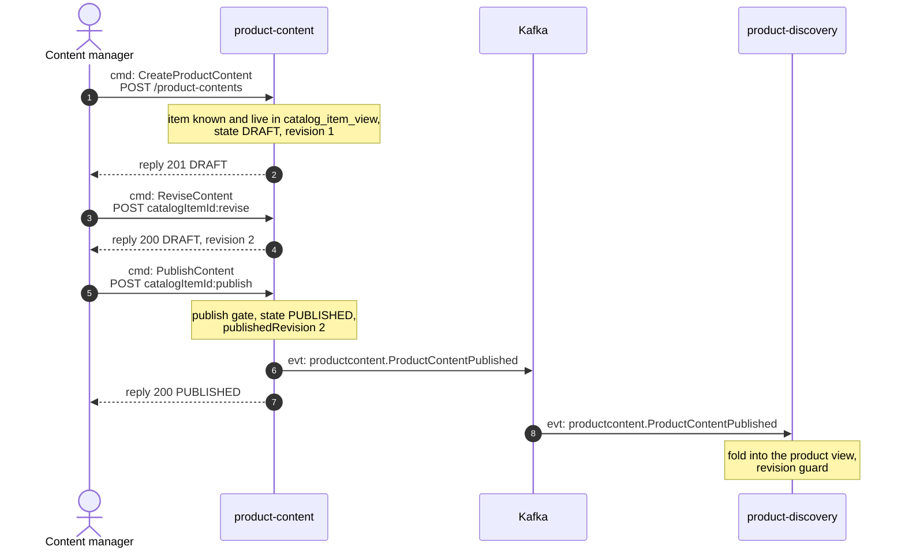
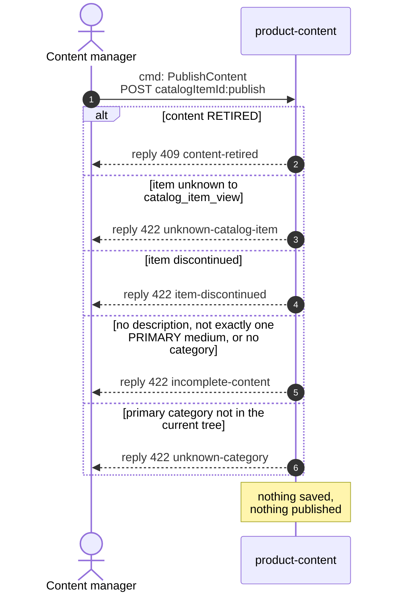
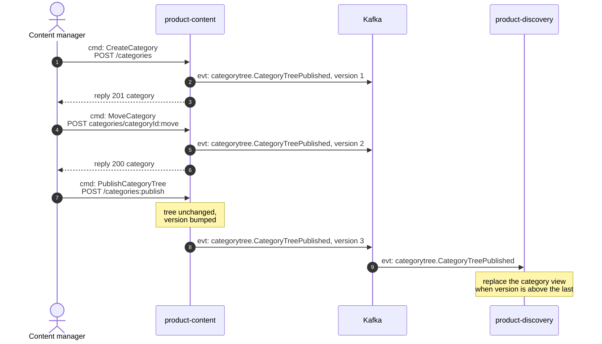
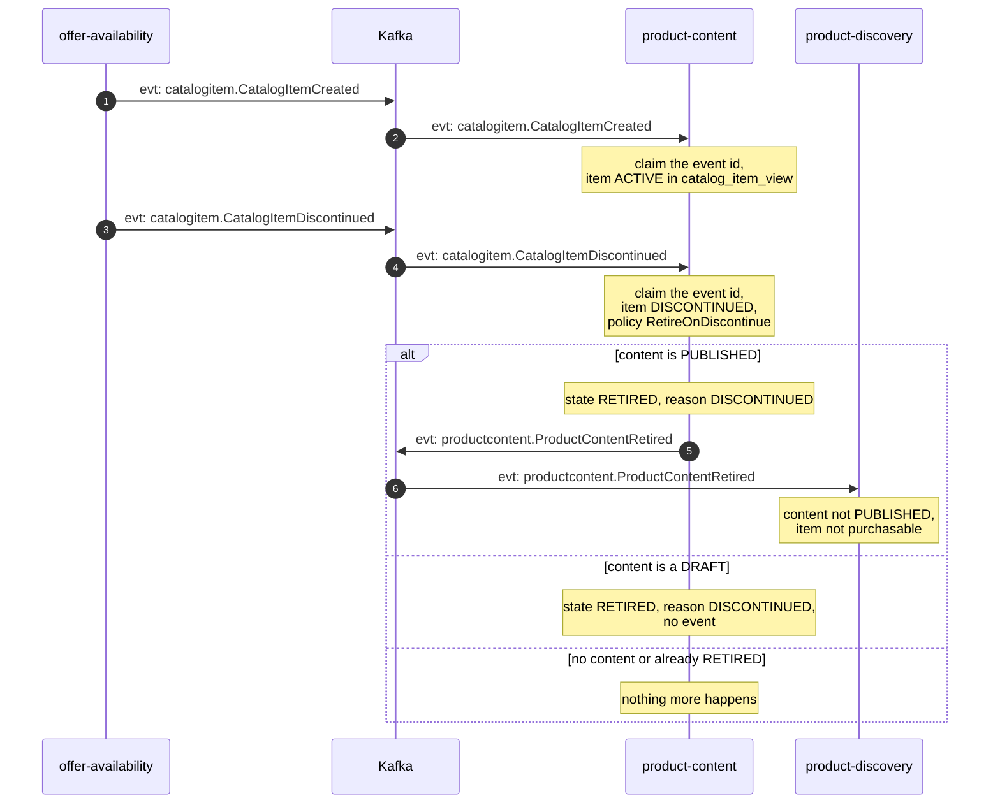
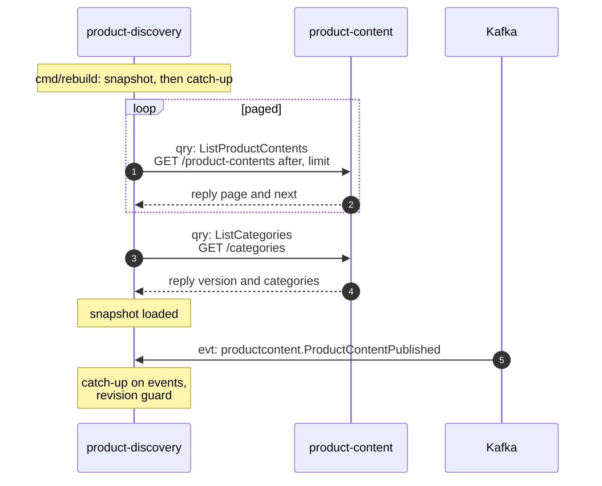

# Domain message flow

Following ddd-crew
[Domain Message Flow Modelling](https://github.com/ddd-crew/domain-message-flow-modelling).
Five scenarios. Participants are contexts and actors. Every arrow is a message
prefixed `cmd:` (command), `qry:` (query) or `evt:` (event). A `Note` names work a
context does on itself. Kafka is drawn as one participant. Event names are written
`entity.EventName`; the full type is
`com.retailnetwork.<tier>.<producer>.<entity>.<EventName>` (see
[Domain events](/docs/ddd/domain-events)). REST path parameters are written without
braces.

## 1. Author and publish content

Source: `internal/application/usecases/content.go` (`CreateProductContent`,
`ReviseContent`, `PublishContent`), `internal/domain/content/commands.go`,
`product-discovery`'s `internal/adapters/inbound/kafka/product_content.go`.

Omitted: the outbox write and relay (the event leaves after the commit, see
[Sequence diagrams](/docs/ddd/sequence-diagrams)), the `Idempotency-Key` handling, and
how the item reached `catalog_item_view` (scenario 4's topic).

## 2. Publish rejected (failure path)

Source: `internal/domain/content/commands.go` (`Publish`, order of the checks),
`internal/adapters/inbound/http/errors.go`.

The manager corrects the DRAFT with `:revise` and publishes again. A publish of the
revision that is already live is not a rejection: it answers 200 and changes nothing.

## 3. Edit the tree

Source: `internal/application/usecases/category.go` (`saveTree` appends the event for
every command), `internal/domain/category/category.go` (`publish`).

Every category command publishes the whole tree under a new version. The structural
errors (`category-cycle`, `max-depth`, `duplicate-sibling-name`, `unknown-category`,
`not-found`) are answered before anything is saved or published.

## 4. Item discontinued: retire the content

Source: `internal/adapters/inbound/kafka/offer_availability.go`,
`internal/application/usecases/consume.go` (`ApplyCatalogItemCreated`,
`ApplyCatalogItemDiscontinued`), `internal/domain/content/commands.go`
(`RetireOnDiscontinue`).

Omitted: the retry and dead-letter path (see
[Integration](/docs/ecosystem/integration#how-every-consumed-message-is-handled)). The
item's own lifecycle is `offer-availability`'s.

## 5. Projection bootstrap: product-discovery reads the snapshot

Source: `internal/application/usecases/queries.go` (`ListProductContents`,
`ListCategories`), and `product-discovery`'s `cmd/rebuild/main.go` on its
`origin/develop`.

Omitted: the other bootstrap reads `product-discovery` does against
`offer-availability` and `pricing`. `GetProductContent` (one item) has the same shape
as one page of the list and is not drawn separately.
