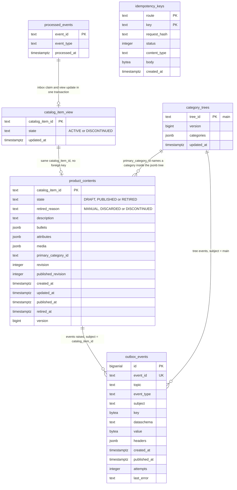

# Entity-relationship diagram

The Postgres schema created by the single embedded migration
`internal/adapters/outbound/postgres/migrations/0001_product_content_schema.up.sql`
(six tables; `.down.sql` drops them). The migrations run at boot of `cmd/api` over
`MIGRATIONS_DATABASE_URL` (default `DATABASE_URL`); `cmd/a2a` reads the same
database and runs none.

Source: `internal/adapters/outbound/postgres/migrations/0001_product_content_schema.up.sql`.
The lines between tables are logical: the schema declares **no foreign key**. The
only constraints are the keys, the `CHECK`s below and `outbox_events.event_id UNIQUE`.

## Tables

| Table | Written by | Notes |
| --- | --- | --- |
| `product_contents` | `ContentRepository.Save` | One row per catalogue item, primary key `catalog_item_id`. The three collections are `jsonb` arrays, default `[]`. `version` is the optimistic-concurrency guard (`UPDATE ... WHERE version = loaded`), a second insert for the same item violates the primary key and is `concurrent-update`. |
| `category_trees` | `TreeRepository.Save` | One row, `tree_id = main`, the whole tree as `jsonb` under its `version`. Absent before the first category. |
| `catalog_item_view` | the consumer, `CatalogItemRepository` | Event-fed local copy: `ACTIVE` or `DISCONTINUED` (terminal). |
| `processed_events` | the consumer, `Inbox.Claim` | The inbox: one row per consumed CloudEvents `id`. Claimed in the same transaction as the effect. |
| `idempotency_keys` | the HTTP middleware, `IdempotencyStore` | Stored response per key; records older than 24 h are treated as absent. Index `idempotency_keys_created_idx` on `created_at`. |
| `outbox_events` | `OutboxRepo.Append`, drained by the relay | Already-encoded CloudEvents bytes, topic, Kafka key, headers. Partial index `outbox_events_unpublished_idx` on `id` where `published_at IS NULL`. `attempts` and `last_error` record relay failures. |

## Constraints worth knowing

- `product_contents.state` is one of `DRAFT`, `PUBLISHED`, `RETIRED`;
  `retired_reason` is one of `MANUAL`, `DISCARDED`, `DISCONTINUED` or null.
- `(state = 'RETIRED') = (retired_reason IS NOT NULL)` and
  `(state = 'RETIRED') = (retired_at IS NOT NULL)`: a retired row always has a reason
  and an instant, any other row has neither.
- `revision >= 1`, `0 <= published_revision <= revision`, `version >= 1`.
- `category_trees.version >= 1` (the empty tree is never stored).
- `catalog_item_view.state` is `ACTIVE` or `DISCONTINUED`.

The schema holds no PII and no price.
