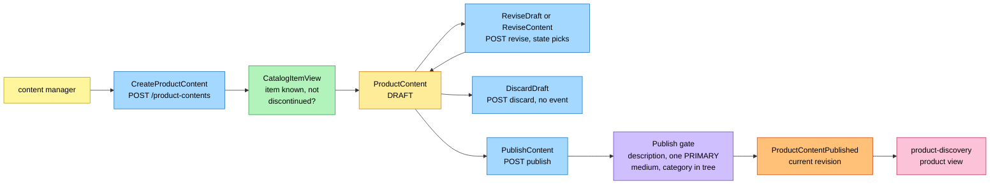
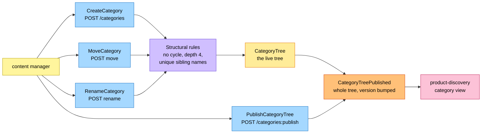

# EventStorming

Process-level boards in the ddd-crew
[EventStorming glossary and cheat sheet](https://github.com/ddd-crew/eventstorming-glossary-cheat-sheet)
notation. Every sticky comes from the code on this branch. Events published by a
neighbour are orange stickies prefixed with the producer. The boards are drawn left
to right and kept narrow. The hotspots at the end are the gaps the design source left
open and how the code closed them.

## Legend

| Colour | Sticky | Meaning here |
| --- | --- | --- |
| Pale yellow `#fff59d` | Actor | The content manager |
| Blue `#a5d8ff` | Command | A command of an aggregate or a use case |
| Yellow `#ffec99` | Aggregate | `ProductContent` or `CategoryTree` |
| Orange `#ffc078` | Domain event | Ours or a neighbour's (prefixed with the producer) |
| Lilac `#d0bfff` | Policy | `RetireOnDiscontinue`, or the publish gate |
| Green `#b2f2bb` | Read model | `CatalogItemView` |
| Pink `#fcc2d7` | External system | A sibling context |

## 1. Authoring and publishing content

Source: `internal/application/usecases/content.go`,
`internal/domain/content/commands.go`, `internal/domain/content/events.go`.

A DRAFT is editable (`ReviseDraft`, new revision) and discardable (`DiscardDraft`,
reason `DISCARDED`, no event because nothing was ever published). Revising PUBLISHED
content (`ReviseContent`) takes a new revision but publishes nothing: the revision
leaves the boundary on the next `PublishContent`, which republishes
(`PUBLISHED` to `PUBLISHED`). Retiring by hand (`RetireContent`) is shown on board 3
as a policy.

Omitted: the invariant errors, the outbox and the `Idempotency-Key` handling.

## 2. Category tree maintenance and publication

Source: `internal/application/usecases/category.go`,
`internal/domain/category/category.go`.

The tree has no draft state: every command applies to the live tree and publishes a
new version carrying the whole tree. `PublishCategoryTree` publishes it again
unchanged so a consumer can resync. There is no remove-category command by design:
categories are created, moved and renamed.

Omitted: the path recomputation a move or rename triggers.

## 3. Retirement on discontinue

Source: `internal/application/usecases/consume.go`,
`internal/domain/content/commands.go` (`RetireOnDiscontinue`).

`RetireOnDiscontinue` also moves a DRAFT to `RETIRED` (reason `DISCONTINUED`, no event,
since nothing was published), and a discontinued item can never publish
(`item-discontinued` on create and publish). A content manager retires PUBLISHED
content by hand with `RetireContent` (`MANUAL`), which raises the same event.

Omitted: the inbox on the CloudEvents `id`, and `CatalogItemCreated`, which only feeds
the view. The shopper-facing consequence (the item stops being purchasable) is
`product-discovery`'s verdict, not a message from this context.

## Hotspots

Each hotspot was a gap in the design source (the storefront model). All are closed in
the code by [ADR 0002](/docs/adr/0002-product-content-assumptions) and
[ADR 0003](/docs/adr/0003-consumed-contracts-and-local-read-model).

| # | Hotspot | How the code closes it |
| --- | --- | --- |
| H1 | A DRAFT could not be edited or discarded. | `ReviseDraft` (`DRAFT` to `DRAFT`, new revision) and `DiscardDraft` (`DRAFT` to `RETIRED`, `DISCARDED`, no event, route `:discard`). One `:revise` route serves both revisions: the state picks the command (A4, A5, A6). |
| H2 | Re-publication after a revision had no transition. | `PUBLISHED` to `PUBLISHED` through `Publish`, carrying the new `revision`. Publishing a revision that is already live is a silent no-op (A1). |
| H3 | `ErrCategoryInUse` was mapped to `:move`. | No remove command exists by design. `ErrCategoryInUse` stays declared and mapped to `category-in-use` (409) but nothing raises it (A8). |
| H4 | No limits on bullets, attributes and media. | `ErrTooManyBullets`, `ErrTooManyAttributes`, `ErrTooManyMedia` at 10, 50 and 12, checked before the fields (A11). |
| H5 | The tree had a DRAFT/PUBLISHED reading. | One live tree, no draft state: every command publishes a new version (A6, A7). |
| H6 | `PublishCategoryTree` had no route. | `POST /categories:publish`. |
| H7 | A DRAFT of a discontinued item stayed behind. | `RetireOnDiscontinue` retires DRAFT content too, silently (ADR 0003). |
| H8 | Content could be created for a discontinued item. | `ErrItemDiscontinued` on create and publish, from `catalog_item_view` (A10). |
