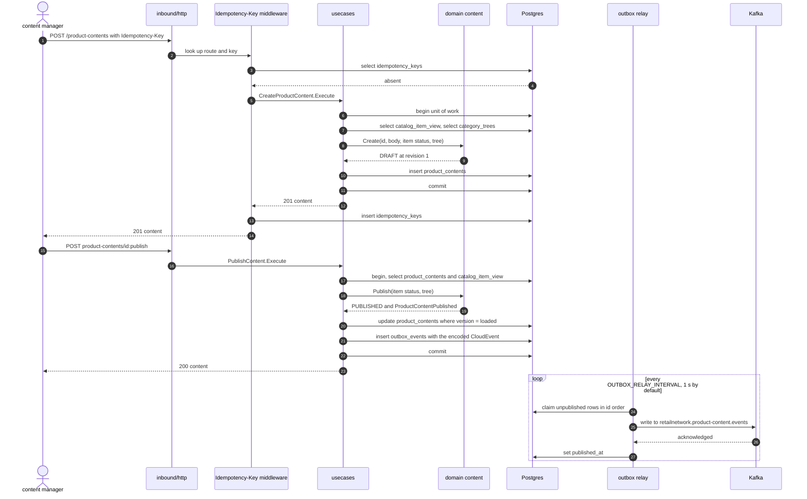
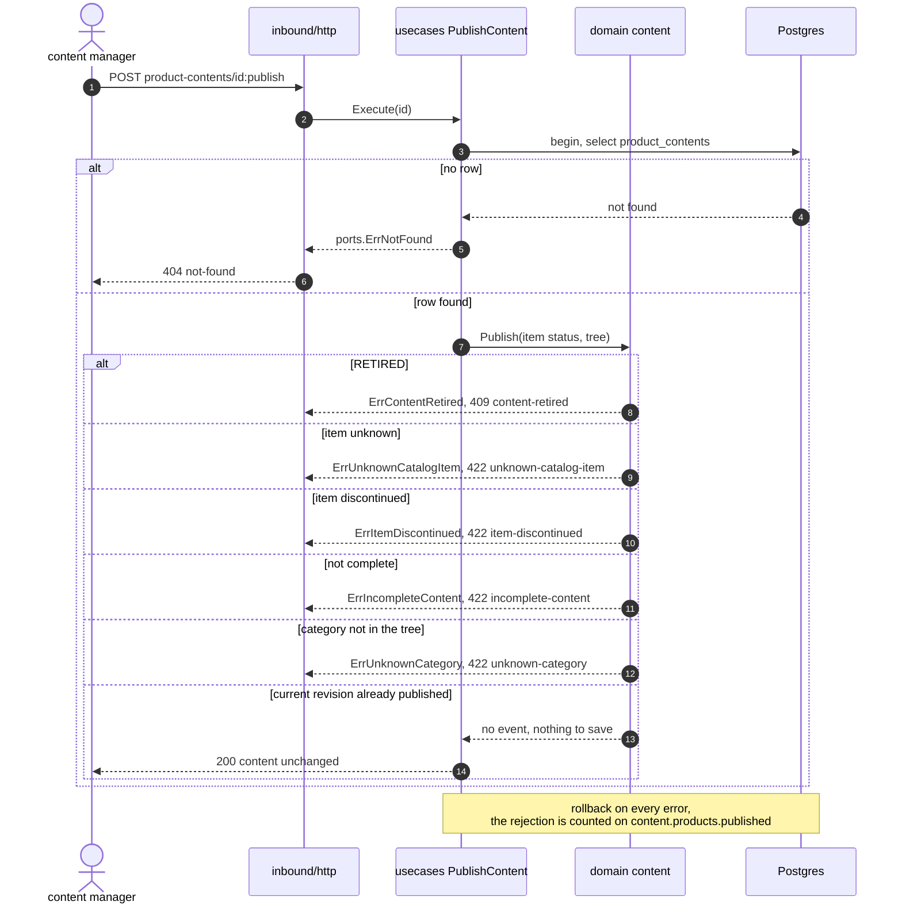
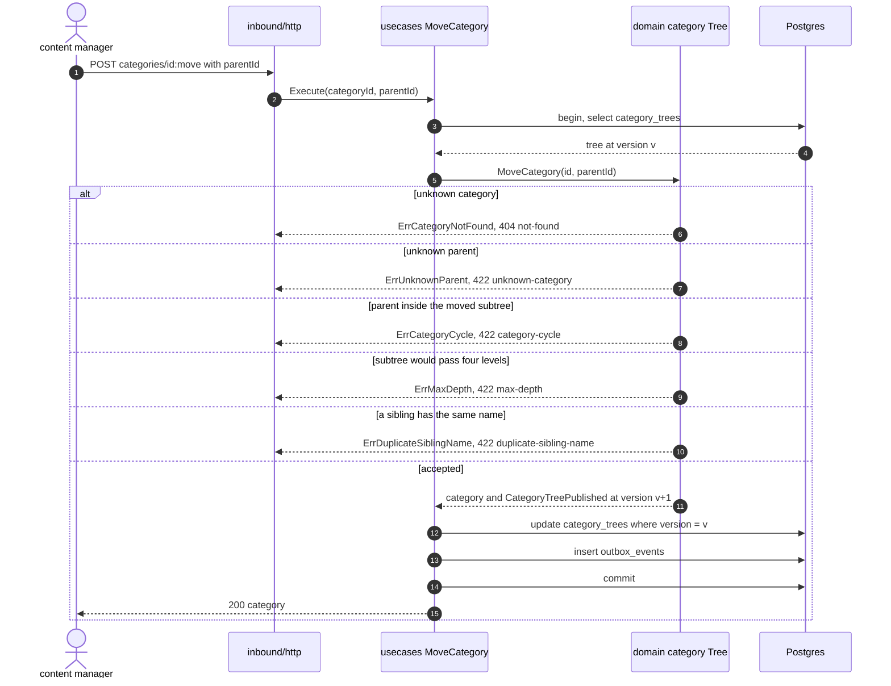
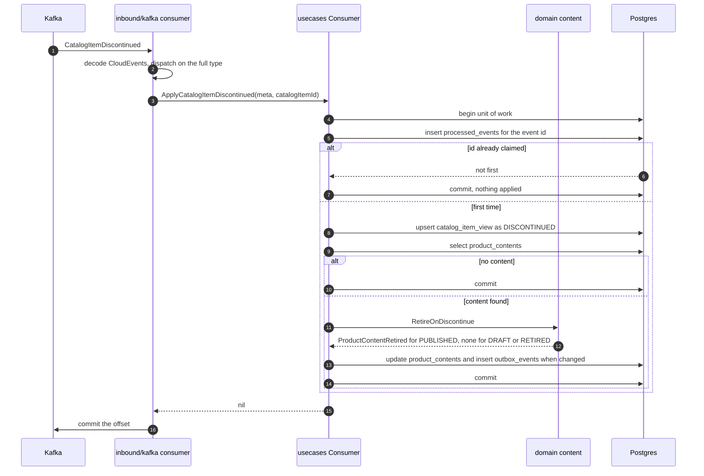
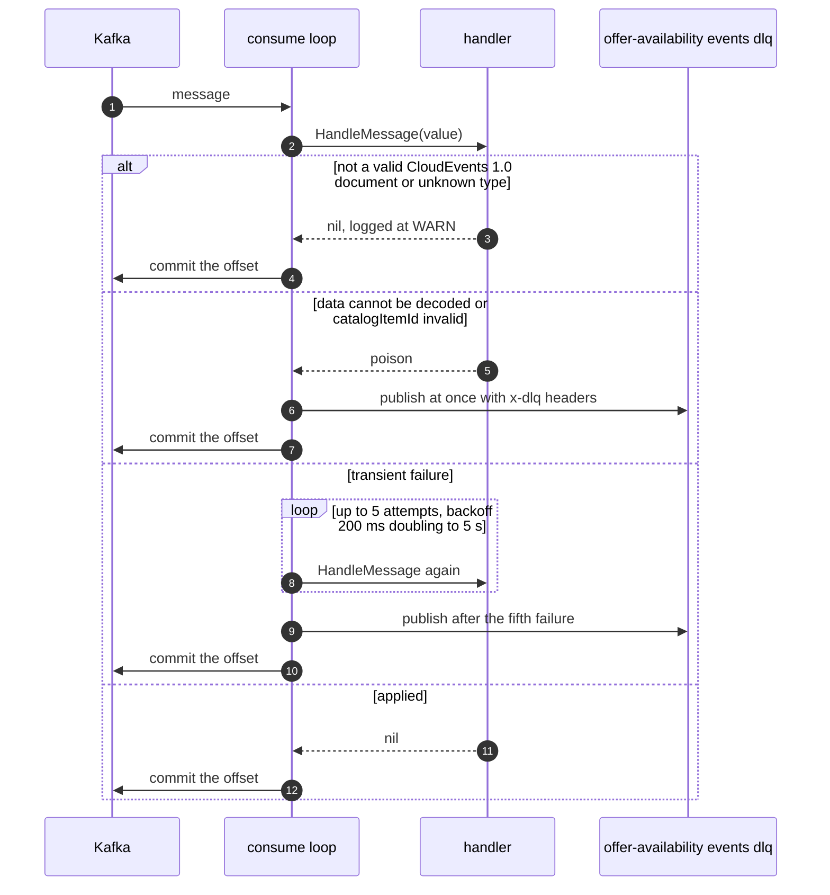
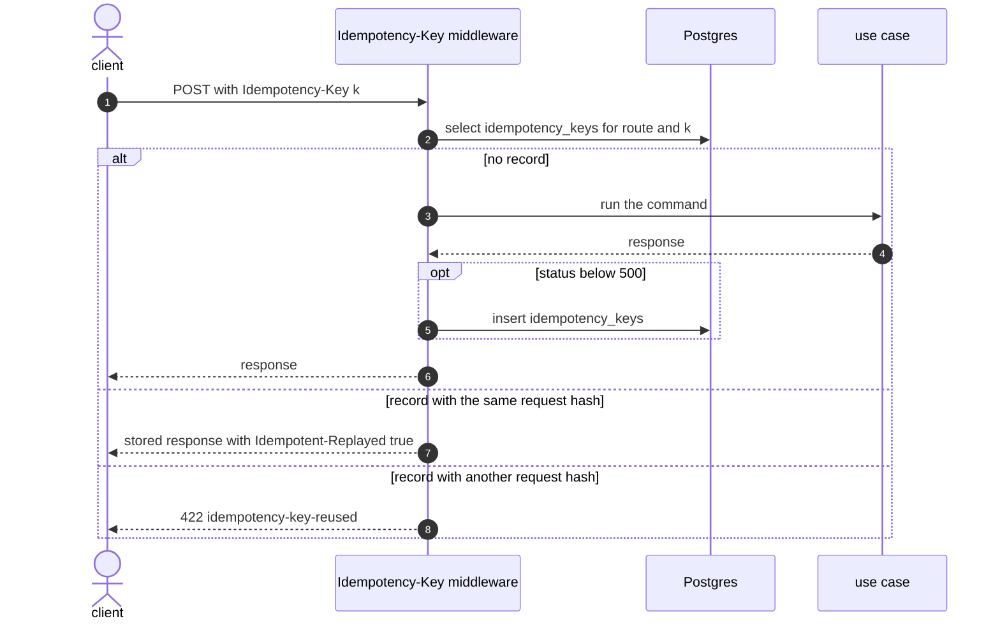

# Sequence diagrams

Six UML sequence diagrams inside the service: how a request or a consumed event
moves through the layers, with the transaction boundary and the error branches.
Participants are code units. Cross-context scenarios are on
[Domain message flow](/docs/ddd/domain-message-flow).

## 1. Create content, revise it and publish it

Source: `internal/adapters/inbound/http/server.go`, `idempotency.go`,
`internal/application/usecases/content.go`, `deps.go` (`transact`),
`internal/domain/content/commands.go`, `internal/adapters/outbound/outbox/relay.go`.

The aggregate row and the outbox row commit in one transaction, so a crash between
save and publish never loses the event. The idempotency record is written by the
middleware afterwards, in its own statement: a crash in between leaves the command
done and the key unrecorded, and a retry with the same key runs the command again
(a repeated create then answers `409 concurrent-update`). The relay repeats the
stored CloudEvents `id` on a retry, so a consumer sees at-least-once delivery of one
stable id.

## 2. Publish rejected

Source: `internal/application/usecases/content.go` (`PublishContent`),
`internal/application/usecases/content_metrics.go`,
`internal/domain/content/commands.go` (`Publish`),
`internal/adapters/inbound/http/errors.go`.

## 3. Edit the category tree

Source: `internal/application/usecases/category.go` (`MoveCategory`, `saveTree`),
`internal/domain/category/category.go` (`MoveCategory`).

A concurrent tree edit fails the conditional update with `ErrConcurrentUpdate`; the
use case runs once more on fresh state and then answers `409 concurrent-update`.
Create, rename and publish follow the same shape.

## 4. Retire on discontinue

Source: `internal/application/usecases/consume.go`,
`internal/adapters/inbound/kafka/offer_availability.go`, `consumer.go`.

The inbox claim, the view update, the content change and the outbox row are one
transaction; the offset is committed after it, so a crash in between replays the
message and the claim makes the replay a no-op.

## 5. Consumer retry and dead letter

Source: `internal/adapters/inbound/kafka/consumer.go`, `kafka.go`, `deadletter.go`.

The loop never commits a message it failed to handle or dead-letter. Shutdown stops
the retries without dead-lettering the message in flight
(`TestDeadLetterCallsGuardCancellation`).

## 6. Idempotent replay

Source: `internal/adapters/inbound/http/idempotency.go`.

A missing or over-long key is `400 idempotency-key-required` before anything runs. A
record older than 24 hours counts as absent.
