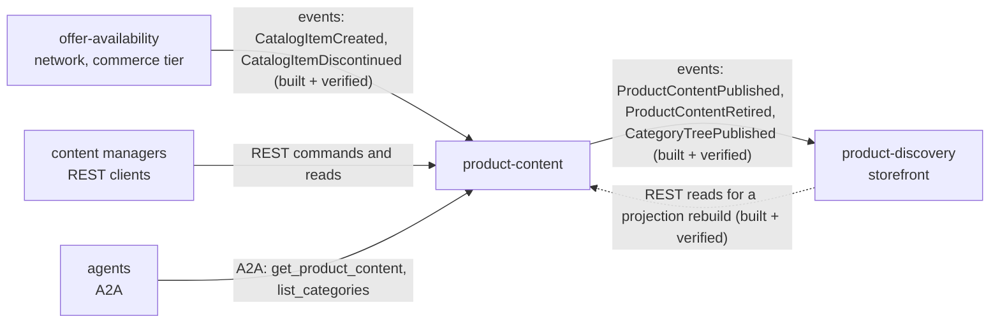

# Integration

How `product-content` fits with the rest of the retail network, with the **status
of every edge**. Three words are used strictly:

- **Built**: code on this repository's branch that does the job.
- **Verified**: the other side was read on its own `origin/develop`
  (`offer-availability` at `2346079`, `product-discovery` at `3391a96`,
  `warehouse-infra` at `b23c321`, read 2026-11-01) and matches.
- **Absent**: no code on either side.

This context calls **no sibling over HTTP, gRPC, MCP or A2A**. It has no outbound
client of any kind: everything it needs to know about a catalogue item arrives as
an event into its own `catalog_item_view`, and everything it tells the others
leaves as an event or as a plain REST read ([ADR 0003](/docs/adr/0003-consumed-contracts-and-local-read-model)).
It never touches the warehouse-systems fleet: it consumes no `warehouse.*` topic
and calls no WMS or WES service.

## Edge map

Source: `internal/adapters/inbound/kafka/offer_availability.go`,
`internal/adapters/outbound/kafka/encoder.go`, `apis/asyncapi.yaml`,
`apis/openapi.yaml`, `internal/adapters/inbound/a2a/skills.go`, and the other
side's `apis/asyncapi.yaml` and `cmd/rebuild/main.go` in `product-discovery` on
`origin/develop`. Solid arrows are events or requests that flow in the arrow's
direction; the dotted arrow is a read in the opposite direction of the data it
returns (the caller is `product-discovery`).

## Upstream (product-content consumes)

| Producer | Protocol | Topic | Contract (full `type`) | Status |
| --- | --- | --- | --- | --- |
| offer-availability | Kafka, CloudEvents 1.0 | `retailnetwork.offer-availability.events` | `com.retailnetwork.commerce.offer-availability.catalogitem.CatalogItemCreated`: reads `data.catalogItemId` only | **Built + verified.** Present in the producer's `apis/asyncapi.yaml`. Inserts the item `ACTIVE` in `catalog_item_view` unless a row exists. |
| offer-availability | same | same | `com.retailnetwork.commerce.offer-availability.catalogitem.CatalogItemDiscontinued`: reads `data.catalogItemId` only | **Built + verified.** Marks the item `DISCONTINUED` (also for an item never seen: the event may overtake its Created) and runs RetireOnDiscontinue on the item's content. |

The relationship is **Conformist**: the item master is the network's, and this
context takes the facts as published. Title, dimensions, GTIN and flags in the
payload are dropped; unknown fields and every other type on the topic are
ignored. The consumer group comes from the mandatory variable
`OFFER_AVAILABILITY_CONSUMER_GROUP` (no default in code; the Helm values in
`warehouse-infra` set `product-content-offer-availability`), see
[Configuration](/docs/operations/configuration).

### How every consumed message is handled

(`internal/adapters/inbound/kafka`, `internal/application/usecases/consume.go`)

- Dispatch on the **full** `type`; any other type is ignored and its offset
  committed.
- A message that is not a valid CloudEvents 1.0 event is logged at WARN and
  committed past; it is not dead-lettered.
- A message of a handled type whose `data` does not decode, or names an invalid
  `catalogItemId`, can never be applied: it goes to the dead-letter topic at once
  (`DeadLetterInvalid` is on for this consumer).
- The claim of the CloudEvents `id` (table `processed_events`) and the effect commit
  in **one** Postgres transaction; the Kafka offset is committed afterwards (at
  least once). A replayed `id` is acknowledged and applied zero times.
- A transient failure is retried with capped exponential backoff (200 ms doubling
  to 5 s) up to 5 attempts, then the message is published to
  `retailnetwork.offer-availability.events.dlq` with `x-dlq-*` headers and the
  consumer moves on. A broker that is gone is retried with the same backoff; a
  consumer or relay that returns on its own makes the process exit non-zero, so
  the orchestrator restarts it.
- Shutdown never dead-letters a message that was in flight
  (`TestDeadLetterCallsGuardCancellation`).
- A group without a committed offset starts at the first offset, so a fresh
  database fed from a retained topic rebuilds `catalog_item_view` by itself.

Consequence for callers: content can only be created after the item's
`CatalogItemCreated` was consumed, so a `422 unknown-catalog-item` can be
projection lag and not a missing item.

## Downstream (product-content publishes)

| Consumer | Protocol | Topic | Contract | Status |
| --- | --- | --- | --- | --- |
| product-discovery | Kafka, CloudEvents 1.0 | `retailnetwork.product-content.events` | `com.retailnetwork.storefront.product-content.productcontent.ProductContentPublished` (key = `catalogItemId`) | **Built + verified.** `product-discovery` lists it in its `apis/asyncapi.yaml` and consumes it in `internal/adapters/inbound/kafka/product_content.go` (consumer group `product-discovery-product-content` in the Helm values). It applies a revision only above the last one it holds and re-indexes the row. |
| product-discovery | same | same | `...productcontent.ProductContentRetired` (key = `catalogItemId`) | **Built + verified.** The item leaves search and is no longer purchasable; a retire of an older revision is stale. |
| product-discovery | same | same | `com.retailnetwork.storefront.product-content.categorytree.CategoryTreePublished` (key = `main`) | **Built + verified.** Carries the whole tree; its `CategoryView` is replaced when `version` is above the last applied one. |
| product-discovery | REST | `GET /product-contents` (paged), `GET /categories` | `cmd/rebuild` in `product-discovery` reads them with `PRODUCT_CONTENT_URL` to rebuild its projection, never on a user request. | **Built + verified** on both sides. Not on the shopper path. |
| content managers, tools | REST | `apis/openapi.yaml` | create, revise, publish, retire, discard, categories | **Built.** Unauthenticated, reached through Kong at `/api/product-content` (`stripPath: true`) per `helm-values/product-content.yaml` in `warehouse-infra`. |
| agents | A2A JSON-RPC 2.0 | `cmd/a2a` on `:8093`, `/` and `/a2a` | skills `get_product_content`, `list_categories` | **Built.** The chart exposes it at `/api/a2a/product-content` when `a2a.enabled=true`, which the `warehouse-infra` values turn on. |

Every event is written to `outbox_events` in the same transaction as the aggregate
and drained to Kafka by the relay (always on) at least once, repeating the stored
CloudEvents `id` on a retry; delivery stops after `OUTBOX_MAX_ATTEMPTS` failures
of one row (default 20), see the [Runbook](/docs/operations/runbook). The envelope
is built only in `internal/adapters/kafka/cloudevents`: `specversion` 1.0,
`source` `/retailnetwork/product-content`, `subject` the aggregate root id (the
`catalogItemId`, or `main` for the tree), `dataschema`
`urn:retailnetwork:product-content:events:<EventName>:v1`, Kafka key = subject, so
all events of one item stay ordered on one partition. Payloads are in
[Domain events](/docs/ddd/domain-events) and the
[Event catalogue](/docs/api-reference/events). Nothing is written to a
`retailnetwork.product-content.analytics` topic: the context declares no
analytics-only event.

## Infrastructure wiring

`warehouse-infra` (`origin/develop`) has an entry for this service:
`terraform/apps.yaml` registers `product-content` as a `service` with a database,
`helm-values/product-content.yaml` and a kind resources file configure the single
`api` Deployment (REST `:8080`, relay and consumer in one process) plus the A2A
Deployment, a Gateway API route `/api/product-content` and the A2A route
`/api/a2a/product-content`, and `terraform/dashboards/contexts/product-content.json`
is the context dashboard (see [Observability](/docs/operations/observability)).
The cluster broker auto-creates the business topics on first write, and the relay's
writer sets `AllowAutoTopicCreation`; `/readyz` waits for a broker, not for a topic.

## Absent edges (on purpose)

- **No synchronous call to any sibling**, in either direction on the request path.
  The only calls that reach this service are `product-discovery`'s bootstrap reads
  and operators' REST calls; the shopper never calls it. The browser reaches the
  storefront edge and reads the catalogue through `product-discovery`.
- **No edge** to `pricing`, `shopping-cart`, `checkout` or `customer-payments`: a
  price, a cart or a payment never names content; the product page is assembled in
  `product-discovery`.
- **No edge** to any network context other than `offer-availability`
  (`delivery-promise`, `customer-ordering`, `order-sourcing`, `shipping-and-tracking`
  and the rest).
- **No MCP server** (`cmd/mcp` does not exist) and **no outbound A2A client**: the
  A2A agent is delegated to, it never delegates (`TestA2AAgentIsReadOnlyWithNoOutboundClient`).
- **No authentication** on REST or A2A, fleet-wide; none is documented here.
- **No Anti-Corruption Layer and no Shared Kernel**: `catalogItemId` and
  `categoryId` are values copied from messages, not shared code.

## Failure behaviour

| Situation | Behaviour |
| --- | --- |
| Postgres down at boot | Migrations and the first ping retry with backoff; on exhaustion the last error is returned and the process exits non-zero, so the orchestrator restarts it. |
| Postgres down at runtime | REST answers 500 `internal-error`; the consumer fails transiently, retries and after 5 attempts dead-letters the message; `/readyz` answers 503 while the ping fails (verdict cached 3 s). |
| Kafka down | REST commands still succeed (the event waits in `outbox_events`), but `/readyz` answers 503 because no broker answers a metadata request. The relay logs `outbox relay pass failed` and retries every interval; the consumer retries with backoff. Kafka connections are lazy, so boot never waits for the broker. |
| Topic does not exist yet | Not a failure: the relay's writer auto-creates it and the consumer retries until it exists. |
| Relay row keeps failing | After `OUTBOX_MAX_ATTEMPTS` the row is excluded from claims and logged once at ERROR; later rows overtake it. Re-arm with `UPDATE outbox_events SET attempts = 0 WHERE id = ...` after fixing the cause. |
| Duplicate or replayed consumed event | Acknowledged, no effect (inbox on the CloudEvents `id`). |
| `CatalogItemCreated` arrives after `CatalogItemDiscontinued` | The item stays `DISCONTINUED`; a late Created never revives it. |
| Poison message | Dead-lettered to `<topic>.dlq`, the partition moves on. |
| `product-discovery` misses events | It rebuilds from `GET /product-contents` and `GET /categories`; a consumer applies a revision only above the last one it holds, and the tree by `version`, so replays and re-publishes are harmless. |
| A consumer wants the tree again | `POST /category-tree-publications` re-sends the whole live tree under a new version. |
| Two writers race on one aggregate | The conditional save fails with `concurrent-update`; commands retry once (2 attempts), consumed events up to 5 times, then REST answers 409. |

Troubleshooting steps for each row are on [Troubleshooting](/docs/operations/troubleshooting).
