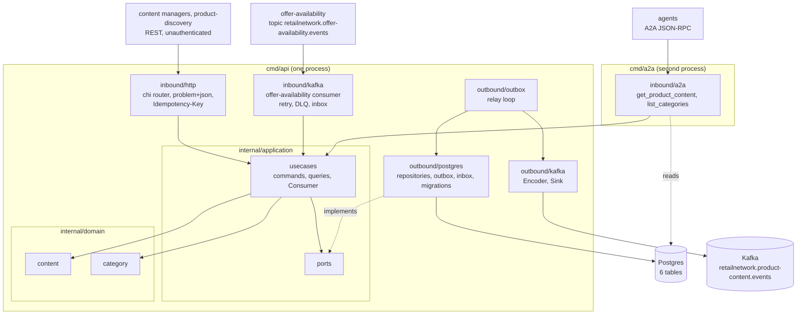

# Architecture

`product-content` follows the fleet's hexagonal (ports and adapters) layout:
dependencies point inward, the domain imports only itself and the standard
library, and only `cmd/` wires the layers together. Everything on this page
is on `develop`.

## Layout

| Layer | Path | Role |
| --- | --- | --- |
| Domain | `internal/domain/content` | The `ProductContent` aggregate: `Body` (description, bullets, attributes, media, primary category), `State` (`DRAFT`, `PUBLISHED`, `RETIRED`), `RetiredReason` (`MANUAL`, `DISCARDED`, `DISCONTINUED`), `Create`, `ReviseDraft`, `ReviseContent`, `Publish`, `Retire`, `DiscardDraft`, `RetireOnDiscontinue`, the events `ProductContentPublished` and `ProductContentRetired`, and the domain errors. |
| Domain | `internal/domain/category` | The `Tree` aggregate (`CategoryTree`): `CreateCategory`, `MoveCategory`, `RenameCategory`, `PublishCategoryTree`, the event `CategoryTreePublished`. Implements `content.Categories` (`Has`). |
| Domain | `internal/domain/shared` | `Event`, `Header`, `ErrValidation`, `ErrIllegalTransition`, id and text validation helpers. |
| Application | `internal/application/usecases` | One struct per use case (see [Use cases](/docs/ddd/use-cases)), `Consumer` (the consumed events), `Deps`, the `transact` retry wrapper. |
| Application | `internal/application/ports` | The OUT ports: `ContentRepository`, `TreeRepository`, `CatalogItemRepository`, `Inbox`, `EventOutbox`, `UnitOfWork`, `IdempotencyStore`, `Clock`, `IDGenerator`, `ContentMetrics`. Interfaces only. |
| Application | `internal/application/readmodel`, `views`, `idempotency`, `outbox` | The `CatalogItem` read model, the response views, the idempotency record, the already-encoded outbox `Message`. |
| Inbound adapter | `internal/adapters/inbound/http` | chi router for `apis/openapi.yaml`: handlers, RFC 9457 problem mapping (`errors.go`), the `Idempotency-Key` middleware, NUL rejection, `/healthz` and `/readyz`. No auth middleware. |
| Inbound adapter | `internal/adapters/inbound/kafka` | The offer-availability consumer: CloudEvents decode, dispatch on the full `type`, retry with backoff, dead-letter topic. Decode only, every effect is a use case. |
| Inbound adapter | `internal/adapters/inbound/a2a` | The read-only A2A agent: Agent Card, two skills, JSON-RPC handler ([ADR 0006](/docs/adr/0006-a2a-inbound-adapter)). |
| Inbound adapter | `internal/adapters/inbound/requestlog` | The request-log middleware that carries `trace_id` and `span_id`. |
| Outbound adapter | `internal/adapters/outbound/postgres` | pgxpool repositories, unit of work (`pgtx`), outbox and idempotency stores, inbox, embedded migrations (`migrations/0001_product_content_schema.*.sql`). |
| Outbound adapter | `internal/adapters/outbound/kafka` | `Encoder` (domain event to CloudEvents outbox message, topic `retailnetwork.product-content.events`), `Sink`, `NewWriter`, `BrokerCheck` (the Kafka half of `/readyz`). |
| Outbound adapter | `internal/adapters/outbound/outbox` | The relay loop that drains `outbox_events` to the sink. |
| Outbound adapter | `internal/adapters/outbound/telemetry` | OTel setup, the `content.products.published` counter, the slog handler that adds trace ids. |
| Outbound adapter | `internal/adapters/outbound/clock`, `ids` | The production `Clock` and category id generator. |
| Outbound adapter | `internal/adapters/outbound/memory`, `repocontract` | In-memory port implementations, a **test double** for the unit and BDD suites, and the repository contract suite run against memory and Postgres. The shipped binaries never import memory (`TestRuntimeBinaryHasNoInMemoryAdapters`). |
| Kafka envelope | `internal/adapters/kafka/cloudevents` | The only place a CloudEvents 1.0 envelope is built or decoded: `New`, `Decode`, `Type`, `DataSchema`, `ContentTypeHeader`. Constants `Tier = "storefront"`, `Context = "product-content"`, `Source = "/retailnetwork/product-content"`. |
| Support | `internal/bootretry` | Exponential-backoff retry for the first outbound dials at boot. |
| Test support | `internal/testing/{kafkatest,pgtest}`, `internal/bdd` | testcontainers helpers and the godog wiring for `features/`. |
| Fitness tests | `internal/architecture` | arch-go and source-scanning tests, listed below. |

The domain asks the rest of the context two questions and gets plain values
back: `content.ItemStatus` (`ItemUnknown`, `ItemActive`, `ItemDiscontinued`),
read by the use case from `CatalogItemView`, and `content.Categories`
(`Has(categoryID)`), implemented by the category tree. That is why the content
package never imports the category package.

## Binaries and ports

| Binary | Role | Port | Probes |
| --- | --- | --- | --- |
| `cmd/api` | REST API, the transactional outbox relay and the offer-availability consumer in one process, all always on, on real Postgres and real Kafka. | `HTTP_ADDR`, default `:8080` | `GET /healthz` (liveness), `GET /readyz` (drain gate, Postgres ping, a Kafka broker answers a topic-less metadata request) |
| `cmd/a2a` | Read-only A2A server over `GetProductContent` and `ListCategories`: JSON-RPC 2.0 at `/` and `/a2a`, Agent Card at `/.well-known/agent-card.json`. No Kafka, no relay, no consumer, no write. | `A2A_ADDR`, default `:8093` | `GET /healthz` for liveness and readiness |

There is no `cmd/mcp`. How `cmd/api` boots, what it starts and in which order
it stops is in the [Runbook](/docs/operations/runbook); every variable is in
[Configuration](/docs/operations/configuration).

## Container and component diagram

Source: `cmd/api/main.go` (`buildAdapters`, `buildServer`, `startConsumers`,
`startOutboxRelay`), `cmd/a2a/main.go` (`readDeps`),
`internal/application/ports/ports.go` (the OUT ports),
`internal/adapters/outbound/kafka/encoder.go` and
`internal/architecture/architecture_test.go`. The in-memory adapters are not in
the diagram because the binaries do not wire them.

## Data stores

One Postgres database, created by the single embedded migration
`internal/adapters/outbound/postgres/migrations/0001_product_content_schema.up.sql`:

| Table | Holds |
| --- | --- |
| `product_contents` | One row per catalogue item: state, retired reason, description, `bullets`, `attributes` and `media` as `jsonb`, primary category, `revision`, `published_revision`, timestamps and the `version` that guards every update. |
| `category_trees` | The one tree, stored whole as `jsonb` under `tree_id = main`, with its `version`. |
| `catalog_item_view` | The event-fed local item copy: `catalog_item_id`, `state` (`ACTIVE` or `DISCONTINUED`). |
| `processed_events` | The inbox: one row per consumed CloudEvents `id`, so each event is applied once. |
| `idempotency_keys` | Stored answers per `(route, key)`; records older than 24 h are treated as absent. |
| `outbox_events` | The transactional outbox: encoded CloudEvents bytes, topic, key, headers, `attempts`, `last_error`, `published_at`. |

Postgres is the only store: the service refuses to boot without
`DATABASE_URL` and nothing is served from process memory. Kafka is the fleet's
single broker. `cmd/api` produces to `retailnetwork.product-content.events`
and consumes `retailnetwork.offer-availability.events`; poison messages go to
`<topic>.dlq`. It never calls a Kafka admin API: the relay's writer sets
`AllowAutoTopicCreation`, and `/readyz` does not wait for any topic. See the
[Entity relationship](/docs/ddd/entity-relationship) page for the columns.

## Rules enforced by `internal/architecture`

The tests run on every PR (`arch-test` job, `make arch-test`):

| Test | Rule |
| --- | --- |
| `TestHexagonalArchitecture` | `**.internal.domain.**` depends only on domain, `**.internal.application.**` only on domain and application, inbound adapters do not depend on outbound adapters and vice versa, nothing under `internal/` imports `cmd`, `internal/application/ports` holds only interfaces. |
| `TestMCPAdapterDependencyRule`, `TestMCPOptionalToolInputsCarryOmitempty` | Guards for an MCP adapter, which this repo does not have. They pass on an empty set. |
| `TestA2AAdapterDependencyRule`, `TestA2AAgentIsReadOnlyWithNoOutboundClient` | The A2A adapter depends only on application and domain, nothing depends on it, it reaches only the two read use cases and imports no A2A client: this context is delegated to, it never delegates. |
| `TestNoAuthMiddlewareReintroduced` | No bearer-token or JWT library in non-comment source under `internal/adapters/inbound`: REST is unauthenticated fleet-wide. |
| `TestKafkaConsumerGroupNeverHardcodedInline` | No literal `GroupID`: the group comes from `OFFER_AVAILABILITY_CONSUMER_GROUP`. |
| `TestRuntimeBinaryHasNoInMemoryAdapters`, `TestRuntimeBinarySensorBites` | No non-test file under `cmd/**` imports `internal/adapters/outbound/memory`. |
| `TestNoEventEnvelopeToggleOrFlatEnvelope`, `TestCloudEventsOnly` | CloudEvents 1.0 is the only envelope. |
| `TestKafkaWritersSetRequiredAcks`, `TestKafkaWriterTopicNotSetTwice` | Every kafka-go `Writer` sets `RequiredAcks`, and a package that sets `Message.Topic` leaves `Writer.Topic` unset. |
| `TestReplayConsumersSetCommitInterval` | A reader with a process-unique group id sets `CommitInterval`. |
| `TestDeadLetterCallsGuardCancellation` | Every function that sends to a dead-letter topic checks cancellation, so shutdown never dead-letters a mid-flight message. |
| `TestOutboxRelaysPassAttemptCap` | Every relay is built with `WithMaxAttempts(...)`. |
| `TestEventCatalogueMatchesContract` | Every full CloudEvents type in `apis/asyncapi.yaml` appears in [ADR 0004](/docs/adr/0004-cloudevents-envelope-and-type-catalogue). |
| `TestKafkaIntegrationTestsUseTestcontainers`, `TestPostgresIntegrationTestsUseTestcontainers` | Integration tests boot their own broker or database. |
| `TestNoGoFilesAtRepoRoot` | No Go file at the repository root. |

Details and commands are on [Testing](/docs/development/testing).
